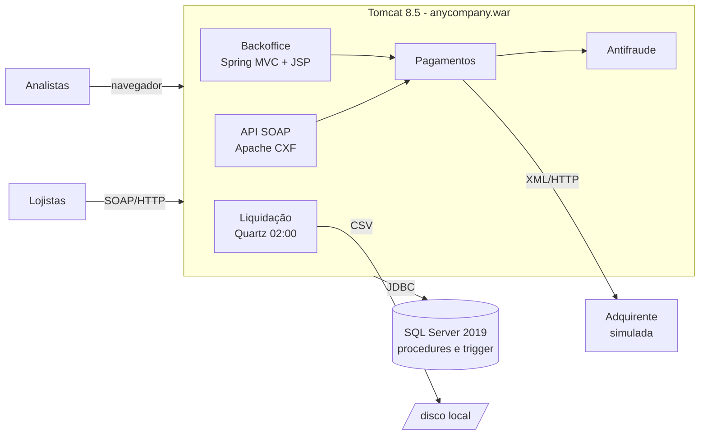
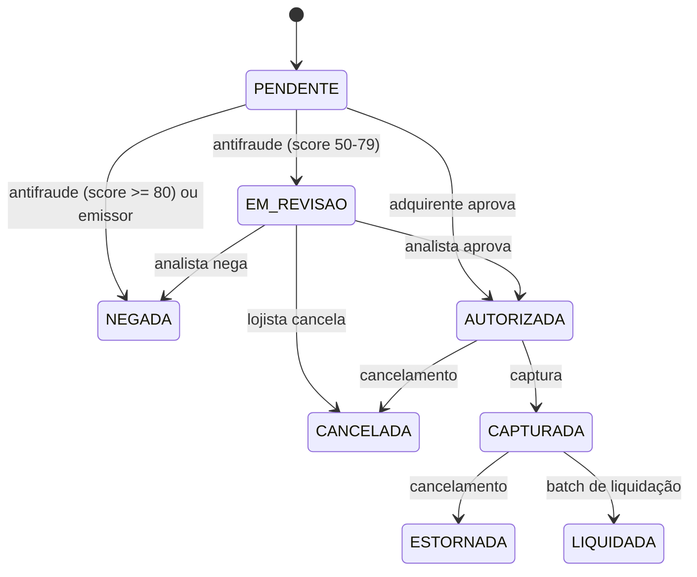

# AnyCompany Gateway (sistema legado)

O AnyCompany Gateway é o sistema de pagamentos da AnyCompany, uma empresa fictícia. Foi criado em 2012. Ele recebe autorizações de cartão de lojistas via SOAP, passa cada transação por um motor de antifraude, envia para a adquirente e, toda madrugada, liquida o que foi capturado. O time que construiu o sistema não está mais na empresa. A versão em produção é a 2.7.3 e roda em VMs VMware num datacenter de colocation.

Seu trabalho é entender esse sistema e modernizá-lo. Comece por aqui:

- [docs/desafio.md](docs/desafio.md): o enunciado do desafio.
- [docs/plataforma-hoje/](docs/plataforma-hoje/README.md): como a plataforma é usada e operada hoje (números, usuários, infraestrutura, manuais, runbook e incidentes).
- [docs/simulador.md](docs/simulador.md): como gerar tráfego de lojistas e reproduzir os problemas da produção na sua máquina.

> **Aviso:** esta aplicação tem dependências desatualizadas e vulnerabilidades conhecidas de propósito. Rode apenas na sua máquina ou numa rede privada. Nunca publique as portas para a internet.

## Arquitetura atual



| Camada | Tecnologia |
|---|---|
| Linguagem | Java 8 |
| Build | Maven 3, empacotado como WAR |
| Servidor de aplicação | Apache Tomcat 8.5 |
| Framework | Spring Framework 4.3 com configuração em XML |
| API dos lojistas | SOAP com Apache CXF 3.1 (JAX-WS) |
| Persistência | Hibernate 4.3 (JPA) e Spring JDBC chamando stored procedures |
| Banco | SQL Server 2019 |
| Batch | Quartz 2.2 dentro da aplicação |
| Backoffice | JSP + JSTL, sessão HTTP |
| Logs | log4j 1.2 |
| Adquirente | Simulada com WireMock |

### Estrutura do repositório

```
legacy-app/            código da aplicação (WAR) e Dockerfile
  src/main/java/br/com/anycompany/
    model/             entidades JPA
    dao/               acesso a dados (Hibernate e JDBC)
    service/           regras de negócio
    ws/                API SOAP
    web/               controllers do backoffice
  src/main/webapp/     JSPs, web.xml e configuração Spring (WEB-INF/spring)
database/              scripts de criação do banco (schema, procedures, dados)
adquirente-simulada/   comportamento da adquirente falsa (mapeamentos WireMock)
simulador/             simulador de uso (lojistas e analista), em Python
balanceador/           NGINX usado no cenário de duas instâncias
exemplos/              clientes de linha de comando para a API SOAP
docs/                  desafio, documentação da plataforma e do simulador
docker-compose.yml                    ambiente padrão
docker-compose.duas-instancias.yml    cenário com duas instâncias do Tomcat atrás do balanceador
docker-compose.apple-silicon.yml      override para Mac M1 a M4 sem Rosetta
```

## Como rodar

### Pré-requisitos

- Um runtime de containers com suporte a compose:
  - **Windows:** [Docker Desktop](https://www.docker.com/products/docker-desktop/) com WSL 2 ou [Finch](https://github.com/runfinch/finch). Use containers Linux (o padrão).
  - **Mac ou Linux:** Finch, Docker Desktop ou Docker Engine.
- 8 GB de memória disponível para a VM de containers. Só o SQL Server usa 2 GB.

### Subindo o ambiente

1. Crie o arquivo `.env` a partir do exemplo e defina as duas senhas.

   ```powershell
   # Windows (PowerShell)
   copy .env.example .env
   notepad .env
   ```

   ```bash
   # Mac/Linux
   cp .env.example .env
   ```

2. Suba tudo:

   ```bash
   docker compose up --build -d
   # ou, com Finch:
   finch compose up --build -d
   ```

   A primeira subida baixa as imagens e compila o projeto. Leva alguns minutos. O serviço `db-init` cria o banco e termina sozinho.

3. Acompanhe até aparecer `Server startup in` no log da aplicação:

   ```bash
   docker compose logs -f app
   ```

**Mac com Apple Silicon (M1 a M4):** a imagem do SQL Server só existe para x86. Ela funciona se a VM de containers tiver Rosetta habilitado. Sem Rosetta, use o override que troca o banco pelo Azure SQL Edge:

```bash
finch compose -f docker-compose.yml -f docker-compose.apple-silicon.yml up --build -d
```

### Endereços

| O quê | Endereço |
|---|---|
| Backoffice | http://localhost:8080/anycompany (usuário `admin`, senha definida no `.env`) |
| WSDL da API SOAP | http://localhost:8080/anycompany/services/PagamentoService?wsdl |
| Adquirente simulada (requisições recebidas) | http://localhost:8090/__admin/requests |
| SQL Server | `localhost,1433`, usuário `sa`, senha do `.env` |

Para o banco, use o SQL Server Management Studio, a extensão SQL Server (mssql) do VS Code ou o DBeaver.

## Testando a API

Cada lojista tem uma API key. Ela é gerada na criação do banco e aparece no backoffice, no menu **Lojistas**.

**Windows (PowerShell):**

```powershell
cd exemplos
$env:ANYCOMPANY_API_KEY = "<api key do lojista>"
.\anycompany.ps1 autorizar 4111111111111111 150.00          # só autoriza
.\anycompany.ps1 autorizar 4111111111111111 150.00 true     # autoriza e captura
.\anycompany.ps1 capturar 401
.\anycompany.ps1 cancelar 401
.\anycompany.ps1 consultar 401
```

Se o Windows bloquear o script: `powershell -ExecutionPolicy Bypass -File .\anycompany.ps1 autorizar 4111111111111111 150.00`.

**Mac, Linux, WSL ou Git Bash:**

```bash
cd exemplos
export ANYCOMPANY_API_KEY=<api key do lojista>
./anycompany.sh autorizar 4111111111111111 150.00 true
```

Você também pode importar o WSDL no SoapUI ou no Postman. Os envelopes de exemplo estão em `exemplos/autorizar.xml` e `exemplos/operacao.xml`.

### Cartões de teste

Use validade `12/30` e qualquer CVV (os scripts já fazem isso).

| Cartão | Comportamento |
|---|---|
| `4111111111111111` | Aprovado (Visa) |
| `5555555555554444` | Aprovado (Mastercard) |
| `4000000000000002` | Recusado pelo emissor (código 05) |
| qualquer cartão com valor terminado em `,51` | Saldo insuficiente (código 51) |
| `4000000000000119` e outros cartões válidos terminados em `0119` | Adquirente demora 60 segundos para responder |
| `4000000000000127` | Adquirente responde HTTP 500 |
| `4000000000000069` | Cartão na lista de bloqueio do antifraude |
| `5299990000000001` | BIN de risco (+30 pontos no antifraude) |
| `4917610000000000` | BIN de risco (+25 pontos no antifraude) |

### Lojistas cadastrados

| Lojista | MDR | Limite por transação |
|---|---|---|
| Loja Exemplo Eletronicos | 2,49% | R$ 5.000,00 |
| Padaria Pao Quente | 1,99% | R$ 500,00 |
| Viagens Ceu Azul | 3,20% | R$ 20.000,00 |
| Loja Antiga Desativada | inativo | |

### Ciclo de vida de uma transação



A pontuação do antifraude aparece no backoffice, em **Regras antifraude**.

## Simulando o uso

O container `simulador` gera tráfego de lojistas e reproduz situações da produção, como a Black Friday:

```bash
docker compose exec simulador simulador dia-normal       # tráfego de um dia comum (Ctrl+C para parar)
docker compose exec simulador simulador black-friday     # pico com adquirente instável, cerca de 9 minutos
docker compose exec simulador simulador sintomas         # o que se acumulou no banco
```

Todos os cenários e o significado de cada coluna do painel estão em [docs/simulador.md](docs/simulador.md).

## Comandos úteis

```bash
docker compose ps                    # estado dos containers
docker compose logs -f app           # log do Tomcat e da aplicação
docker compose exec app ls /usr/local/tomcat/liquidacao   # arquivos de liquidação gerados
docker compose up --build -d app     # recompila e sobe só a aplicação
docker compose down                  # para tudo (mantém o banco)
docker compose down -v               # para tudo e apaga o banco (recria do zero na próxima subida)
```

Troque `docker compose` por `finch compose` se estiver usando Finch.

## Rodando na AWS (opcional)

Se quiser subir o legado ou a sua versão modernizada numa conta AWS própria:

- Crie um alerta de custo no AWS Budgets antes de qualquer coisa e desligue os recursos quando não estiver usando.
- O caminho mais simples para o legado é uma instância EC2 Linux com 8 GB de memória rodando o mesmo `docker compose`.
- Não abra nenhuma porta no security group. Acesse a instância pelo Session Manager e use port forwarding para chegar ao backoffice:

  ```bash
  aws ssm start-session --target <id-da-instancia> \
    --document-name AWS-StartPortForwardingSession \
    --parameters '{"portNumber":["8080"],"localPortNumber":["8080"]}'
  ```

- Nunca libere as portas 8080 ou 1433 para `0.0.0.0/0`. O legado tem falhas de segurança conhecidas.
