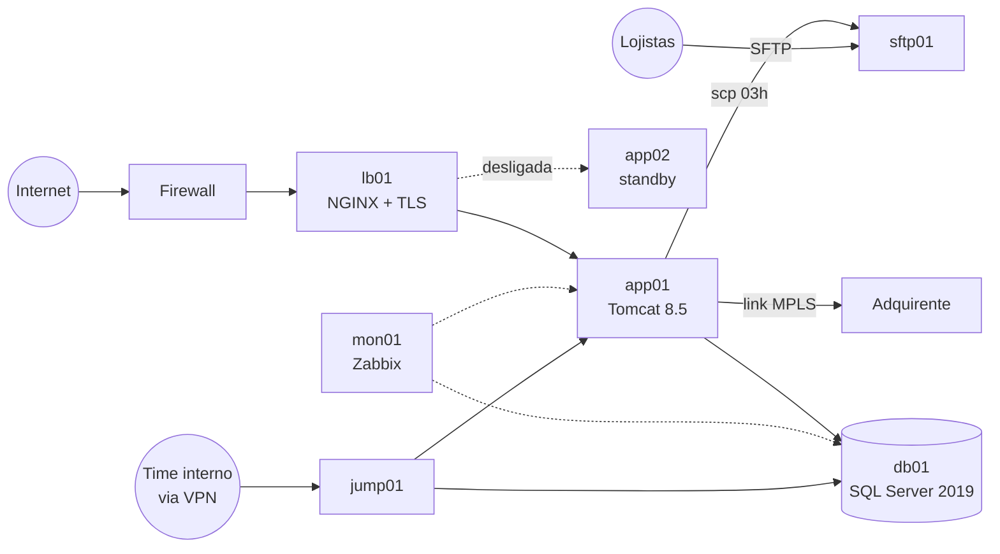

# Infraestrutura

## Visão geral

A produção roda num datacenter de colocation em São Paulo, num cluster VMware vSphere 6.7 (sem suporte do fabricante desde outubro de 2022) com 3 hosts Dell PowerEdge R730 de 2016 e um storage SAN iSCSI da mesma época. Não existe site de contingência.

## VMs

| VM | Função | Sistema operacional | Recursos |
|---|---|---|---|
| lb01 | NGINX 1.14 como proxy reverso. Termina o TLS da API e do backoffice | CentOS 7 | 2 vCPU, 4 GB |
| app01 | Tomcat 8.5 + Java 8 com o `anycompany.war`. Recriada em maio de 2024 a partir do novo template padrão de VM | CentOS 7 | 8 vCPU, 16 GB |
| app02 | Cópia da app01 para contingência. Fica desligada (ver INC-2025-021) | CentOS 7 | 8 vCPU, 16 GB |
| db01 | SQL Server 2019 Standard | Windows Server 2016 | 8 vCPU, 64 GB, 2 TB no SAN |
| sftp01 | SFTP onde os lojistas baixam os arquivos de liquidação | CentOS 7 | 2 vCPU, 4 GB |
| mon01 | Zabbix 4.0 | CentOS 7 | 2 vCPU, 8 GB |
| jump01 | Acesso administrativo (SSH e RDP) para o time interno | Windows Server 2012 R2 | 2 vCPU, 8 GB |

O CentOS 7 está sem atualizações de segurança desde junho de 2024. O Windows Server 2012 R2 está sem suporte desde outubro de 2023.

## Rede

- Firewall FortiGate com dois links de internet de 500 Mbps.
- Só a porta 443 do lb01 fica aberta para a internet.
- Um único link MPLS liga a app01 à adquirente. O protocolo é XML sobre HTTP, sem TLS, porque "o MPLS já é uma rede privada".
- O time interno acessa o jump01 por VPN a partir do escritório.

## Banco de dados

- SQL Server 2019 Standard na db01, com um banco só (`AnyCompany`) e o schema `dbo` para tudo.
- 1,8 TB. A tabela `Transacao` tem 410 milhões de linhas e cresce cerca de 3,6 milhões por mês. Não há particionamento nem expurgo.
- A aplicação conecta com o usuário `sa`.
- Manutenção de índices aos domingos, às 4h.

## Backup e recuperação

| Item | Como é hoje |
|---|---|
| Backup completo do banco | Todo dia às 23h, para um NAS no mesmo rack |
| Backup de log | A cada 1 hora, para o mesmo NAS |
| Cópia externa | Fita semanal levada para um cofre |
| Backup das VMs | Snapshot mensal, guardado no próprio storage |
| Último teste de restore | 2021 |
| RPO / RTO formalizados | Não existem |

## Ambiente local x produção

| Produção | Ambiente local (`docker compose`) | Diferenças |
|---|---|---|
| lb01 (NGINX) | Não existe. Só aparece no cenário de duas instâncias (serviço `balanceador`) | Sem TLS no local |
| app01 | Serviço `app` | Mesmo WAR e mesma configuração |
| app02 | Serviço `app2` no cenário de duas instâncias | |
| db01 | Serviço `sqlserver` | No local o SQL Server roda em Linux e o banco começa com 400 transações |
| Adquirente via MPLS | Serviço `adquirente` (WireMock) | Comportamento simulado |
| sftp01 | Não existe | Os arquivos ficam dentro do container `app` |
| mon01, jump01 | Não existem | |
| Lojistas | Serviço `simulador` | Ele também abre o backoffice a cada 10 s, como um analista. Ver [simulador](../simulador.md) |
